I test drove a range of SUVs in August and September 2026 to compare how they drove, their interiors and their software.

<!-- more -->

```toc
# This code block gets replaced with the TOC
```

## Tier List

Here is the [tier list](https://tierbuddy.com/list/calvin-and-tuhins-ev-testing-tier-list/69222886-de76-4e0d-9357-125b049a908b):

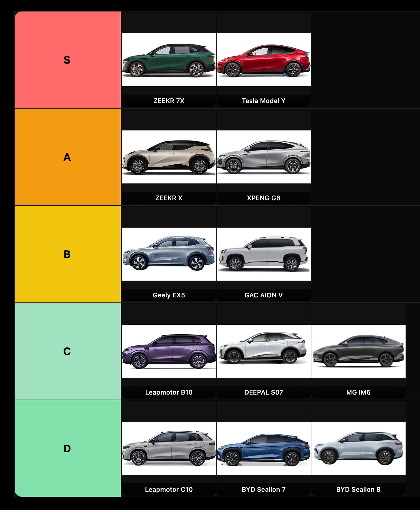

## What I Tested

These are impressions from roughly one-hour test drives. The comparison uses the top Australian trim of each model available at the time.

On each test drive, I focused on acceleration, handling, ride comfort, software responsiveness and usable storage. I also compared battery capacity, charging speed and motor power. A few features come up throughout the post:

- **One-pedal driving.** Lifting off the accelerator slows the car through regenerative braking. I cared about how smoothly it worked and whether it could bring the car to a stop and hold it there.
- **Ventilated and massage seats.** Ventilated seats move air through the seat to help keep you comfortable. As I wrote about my [Hyundai i30 SR Premium](/hyundai-i30-sr-premium-hatchback/), they are a feature I don't want to give up. Massage seats were another comfort feature I looked for.
- **Roof sunshade.** A physical blind that closes beneath the glass roof. In Australia's heat, I want to be able to block direct sunlight overhead and keep the cabin comfortable. A built-in shade is much more convenient than fitting and storing a separate cover.
- **Head-up display (HUD).** Projects information such as speed and navigation onto the windscreen, so I can see it without looking down at a screen.
- **Android Auto.** Puts my phone's maps, music and other supported apps on the car's screen. I expect it in a modern car.
- **Frunk.** A front boot under the bonnet, useful for keeping charging cables and other items out of the main boot.
- **AC and DC charging.** AC is used by the usual home and destination chargers, while DC is for faster public charging stops. Charging power is measured in kW, while battery capacity is measured in kWh.
- **Vehicle-to-load (V2L).** Lets the car's battery power external appliances through a power outlet, which could be useful while camping or during a power cut.

## Zeekr 7X (Performance AWD)

The [Zeekr 7X](https://www.zeekrlife.com/en-au/models/zeekr-7x/) made the strongest first impression for comfort. The Nappa leather, massage seats, air suspension and automatic doors all contributed to an interior that felt expensive. I particularly liked the white interior, and the back seats felt so roomy compared with our Hyundai i30.

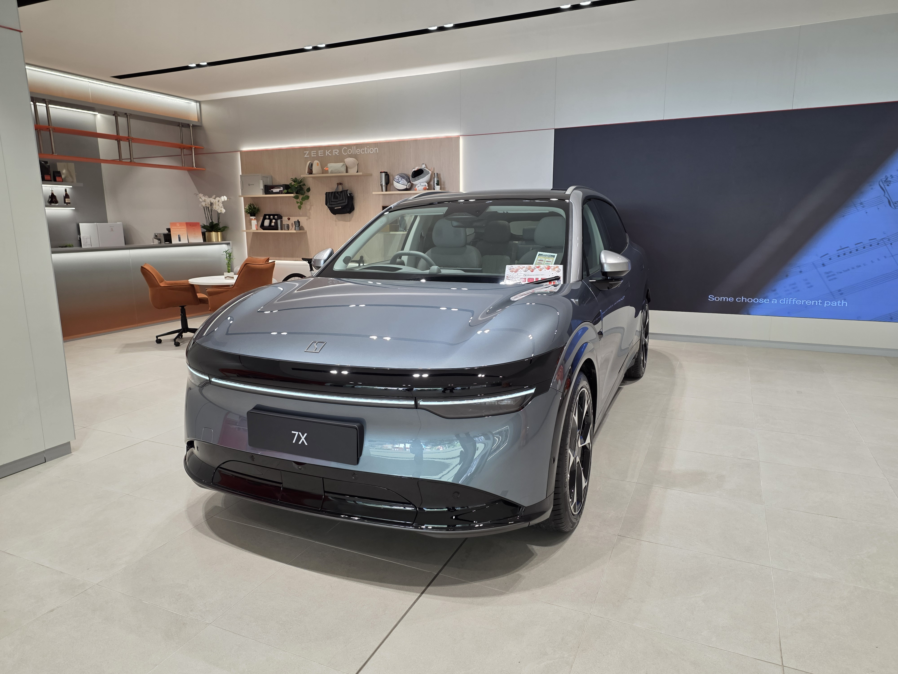

The air suspension took the edge off bumps, something our friends who came along also noticed. The car rocked back and forth when coming to a stop, which I suspect was also down to the suspension.

The steering was light, and the acceleration only felt smooth and immediate in Sport mode. The one-pedal driving was underwhelming.

The head-up display was a highlight, and it also had a frunk, V2L and an electric roof sunshade. The 360-degree camera looked good but did not always appear when I wanted it to. The traffic visualisation was often inaccurate.

The battery and charging package was another draw: a large 100 kWh battery, fast DC charging and up to 22 kW AC charging on a suitable three-phase charger.

For a luxury car, the 7X felt like good value and was one of the more affordable options I considered with air suspension.

## Tesla Model Y (Performance)

The [Tesla Model Y](https://www.tesla.com/en_au/modely) was the best car to drive out of this group. It felt sharp and predictable, with good one-pedal driving. The screen was smooth and responsive, and the sound system was good.

Full Self-Driving (Supervised) is probably the only reason I would buy a Tesla. Its maturity as an EV brand and its warranty were reassuring too.

I respect the clean interior design and think it looks nice, but it reminded me of a display home: easy to admire when the surfaces are empty, until you start wondering where all your everyday stuff would go.

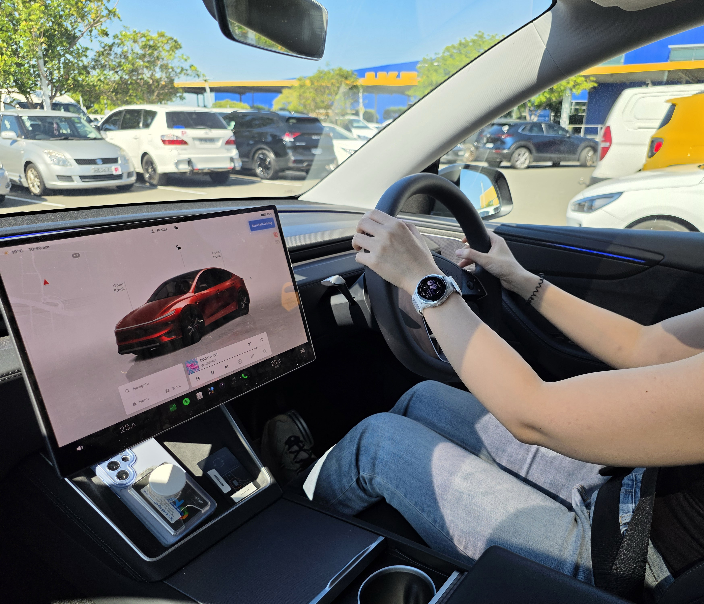

The boot and frunk had good storage, but the cabin was less useful than I wanted. The glovebox was tiny, I wanted more storage between the front seats, and the doors felt heavy.

There were no massage seats, and I could barely feel the seat ventilation. Coming from the i30, that was disappointing. There was no built-in roof sunshade either. Tesla sells a removable shade.

I also disliked the lack of Android Auto and the [extra monthly subscription for cellular streaming](https://www.tesla.com/en_au/support/connectivity) when my phone and data plan are already right there. I could use Bluetooth or a hotspot, but I would rather use Android Auto.

The 11 kW AC charging limit and lack of V2L on some Teslas were other annoyances. [V2L compatibility depends on the individual vehicle](https://shop.tesla.com/en_au/product/tesla-outlet-adapter). These choices feel weird to me, as though everything has to be done the Tesla way.

The Elon Musk association was another negative for me. Some Tesla owners seem delusional about the brand, treating FSD as proof that Tesla invented everything and must be the best at everything. I wish they would look at what other brands are doing. It reminds me of the same blind loyalty around Apple.

Even with those complaints, the Model Y belongs in S tier for me. FSD, the driving experience and the software easily outweigh the negatives.

## Zeekr X (AWD)

The [Zeekr X](https://www.zeekrlife.com/en-au/models/new-zeekr-x/) was good to drive, and I thought the all-wheel-drive version was worth the extra money. The Yamaha sound system was another strong point.

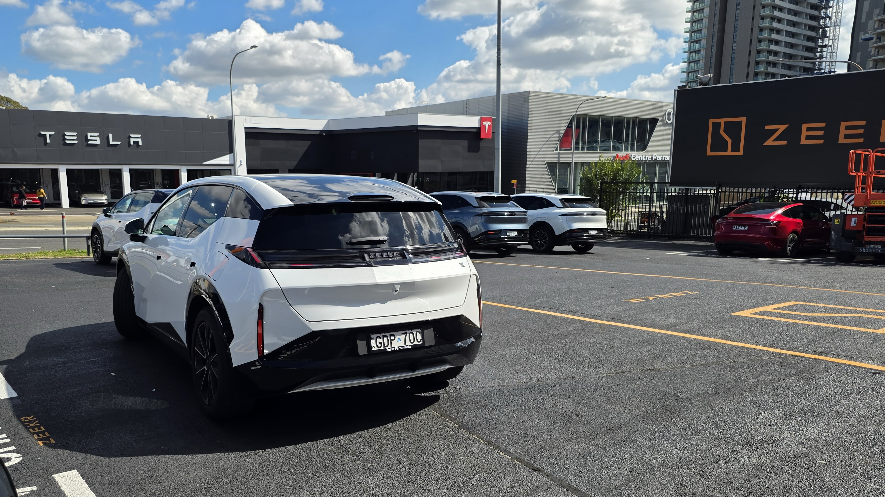

The AWD also had a fridge, front massage seats, a head-up display and a small frunk. It had no built-in roof sunshade.

The screen on the B-pillar was particularly unusual. It could show the charge status, whether the doors were locked and features such as pet mode, all from outside the car.

The main screen felt laggy, and the steering wheel buttons were difficult to use. There were controls on the left and right, as usual, plus controls at the bottom of the steering wheel. Their functions were not clearly labelled or intuitive, so it was difficult to tell what each button did.

## XPeng G6 (AWD Performance)

I drove the updated [XPeng G6](https://www.xpeng.com/au/model/New_G6) and liked it. It was very quick, the screen was responsive with little lag, and the speakers sounded good.

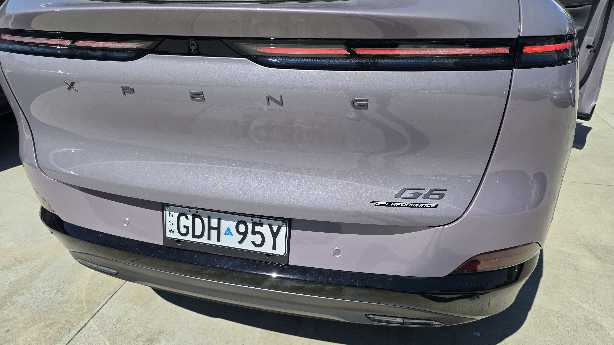

Its fast DC charging was another strong point, although its AC charging was slower than the 7X. It also offered front massage seats and V2L.

The digital rear-view mirror was less impressive, and I missed having a head-up display. There was no glovebox, frunk or built-in roof sunshade. One-pedal driving had a catch too: with the settings I used, the car still rolled on a hill.

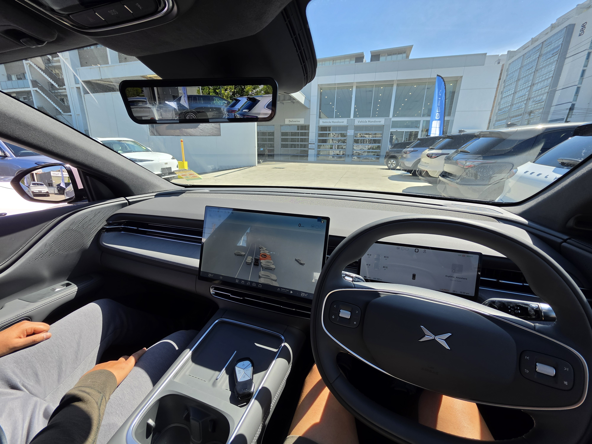

## Geely EX5 (Inspire)

The [Geely EX5](https://www.geely.com.au/models/EX5) was a good baseline for the comparison. The 2026 Inspire Extended Range was listed at [**$45,990 before on-road costs**](https://www.redbook.com.au/cars/details/2026-geely-ex5-inspire-extended-range-auto-my27/SPOT-ITM-689658), with a head-up display, massage seats and a sunroof with a built-in sunshade. That was a lot of the equipment I wanted without moving into the more expensive cars.

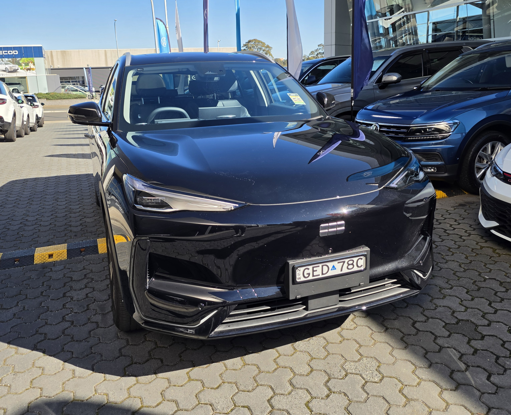

Driving was less impressive than the feature list. It was front-wheel drive, which I have never liked. Acceleration felt a little slow and clunky, and the car felt heavy to drive. It was still adequate for everyday use, but it did not have an immediate, smooth response.

The sound system was below average as well. I liked the EX5's equipment and overall value more than its driving feel or audio, which is why it sits fairly high overall without being one of my favourites on the road.

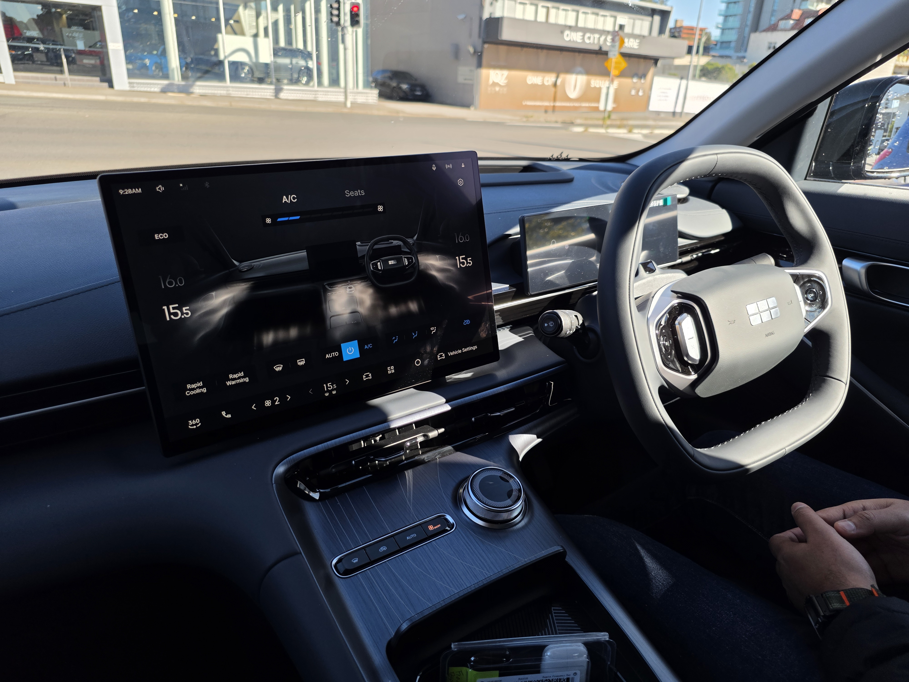

## GAC AION V (Luxury)

The [GAC AION V](https://www.gacgroup.com/en-au/suv/aion-v)'s fridge, massage seats and folding table for the rear passengers were its main attractions. The panoramic roof also had an electric sunshade.

Despite all that equipment, the interior itself did not impress me much. The sound system was average, and I missed having a head-up display. There was also no glovebox or frunk.

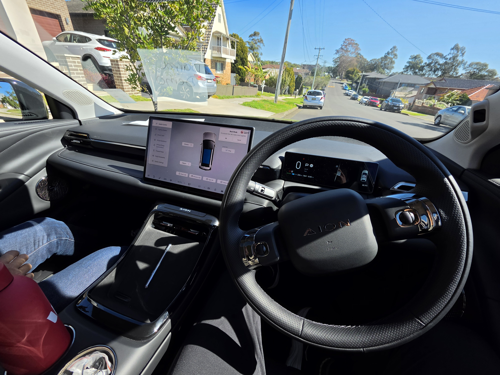

Driving was similarly unremarkable. The heat pump made noticeable noise even while stopped.

## Leapmotor B10 (Design LR)

The [Leapmotor B10](https://www.leapmotor.net/en-au/models/b10) missed some of the comfort features I liked elsewhere, including massage seats and a head-up display. It had an electric roof sunshade. The boot felt too small, and there was no frunk on the car I drove.

There were also holes in front of the passenger seat that looked like they were meant to hold something. I could not think of anything that would fit except a few roses. It was a strange use of the space.

The cameras and traffic visualisation were disappointing. The camera feed lagged, while the visualisation did not accurately reflect the cars around me and was poor at showing lane markings. These were features I wanted to be able to glance at and understand immediately, so the delay and inaccurate display were hard to ignore.

## Deepal S07

The [Deepal S07](https://www.deepal.com.au/vehicles/deepal/s07/) felt smoother under acceleration than the Geely. It had a frunk, a head-up display, an electric roof sunshade and controls for the rear passengers. The centre screen was angled towards the driver.

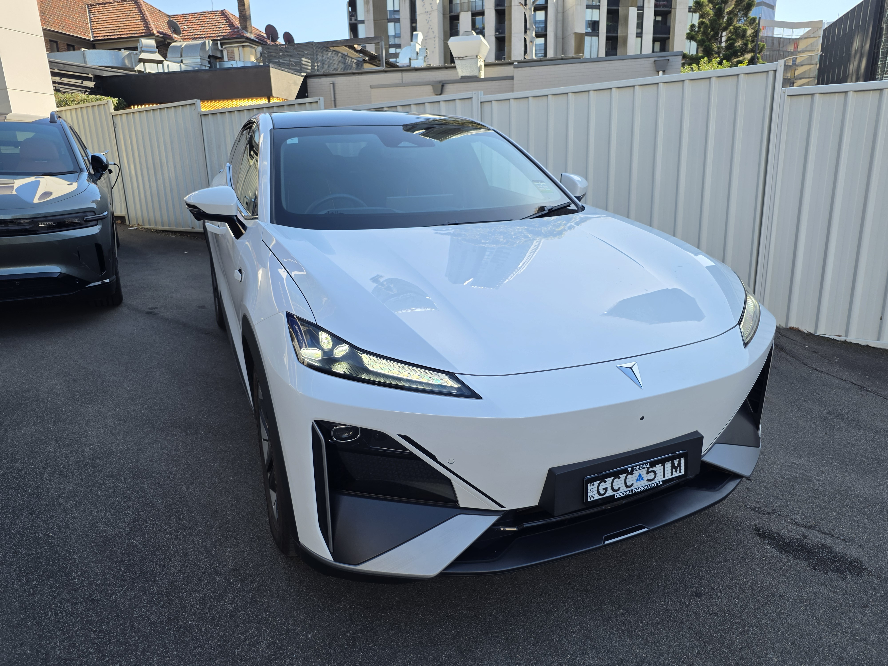

The cabin was clearly trying to feel premium, but it did not quite get there for me. There was no storage underneath the centre console, and changing between drive and reverse felt slow.

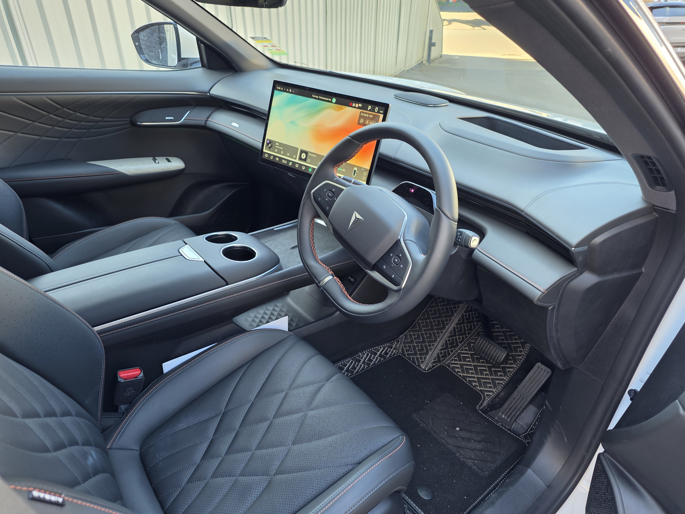

It also kept making noises that reminded me of a petrol car. I could not tell whether I was hearing a fan, heat pump or something else.

## MG IM6 (Performance)

The [MG IM6](https://mgmotor.com.au/vehicles/im6) was very fast, but the interior felt bulky and crowded. There was a lot around me without much sense of space. The screens felt small relative to their surrounds, with large bezels, and the interface lagged. The sound system was poor too.

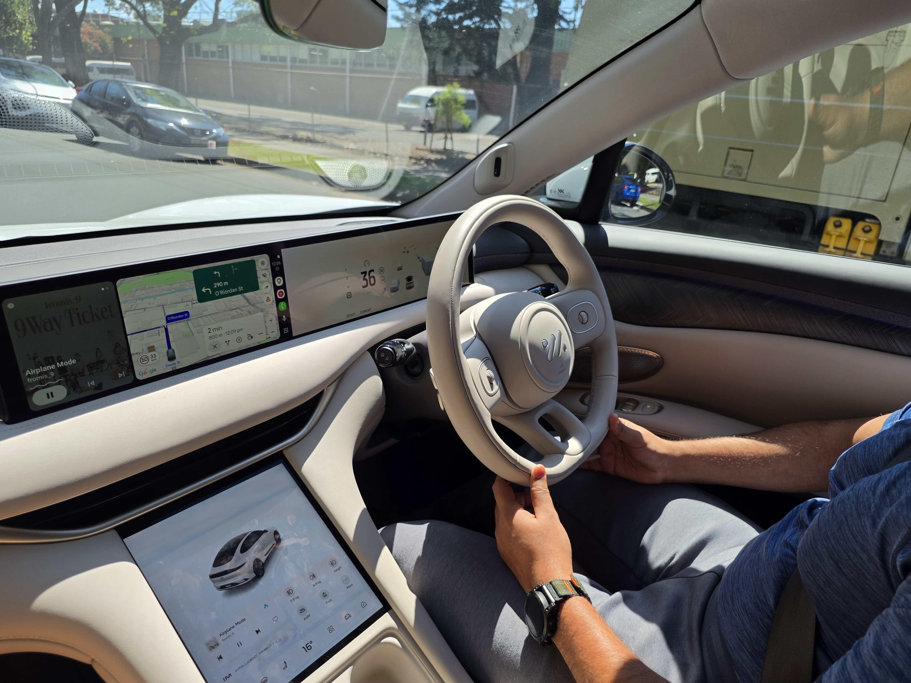

Storage was adequate, including a frunk. The centre armrest lid was heavy. I missed having a head-up display, and there was no built-in roof sunshade.

I could not find a way to adjust steering and brake feel independently of the driving modes during the test drive.

I also struggled to feel confident in IM/MG after driving the MG3, which was the worst car I have ever had the displeasure of driving.

## Leapmotor C10 (AWD Sports+)

The [Leapmotor C10](https://www.leapmotor.net/en-au/models/c10) had good acceleration and was up with the Zeekrs for driving, but its software and storage pulled it down to D tier.

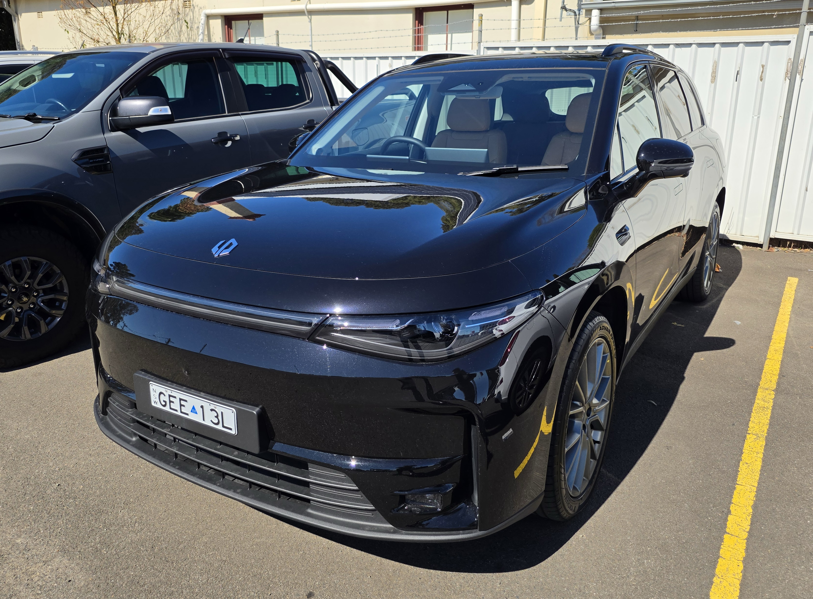

The interior looked nice and had an electric roof sunshade. The car I drove had no Android Auto, and I disliked the built-in navigation. Storage was limited, with a small glovebox and no frunk. The cameras did not automatically appear when turning or changing lanes either.

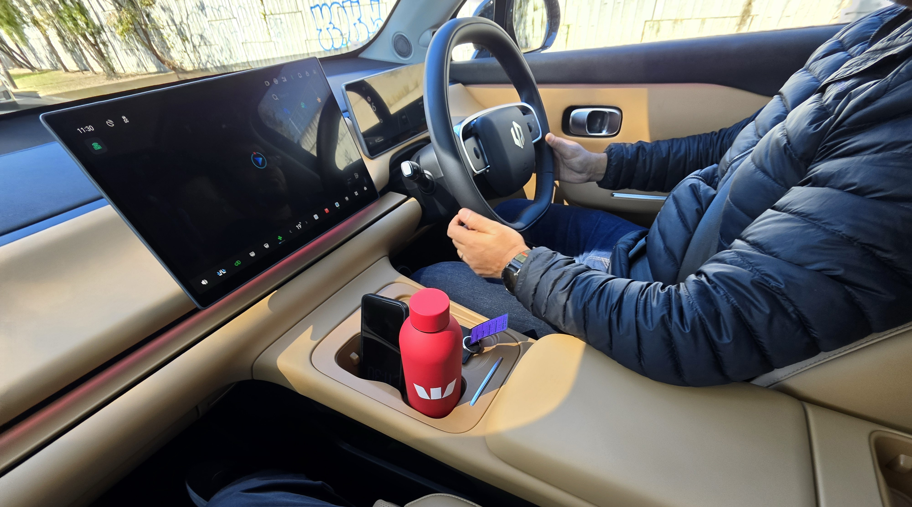

I preferred driving the C10 to the B10, but its omissions made it hard to justify the price.

## BYD Sealion 7 (Performance)

The [BYD Sealion 7](https://bydautomotive.com.au/sealion-7) felt like a modern Toyota to me: solid and rugged, with good storage, but an uninspiring interior and dated software. The leather felt hard, the steering was heavy even in Comfort mode, and the air conditioning felt weak. The panoramic roof had an electric sunshade. On the road, it had a slight rumble that reminded me of a petrol car.

The passenger also had a screen in front of them that could only show light animations. I was told it worked as a TV in China. For us, it felt like a waste of space and money.

BYD's maturity as a brand and its warranty counted in its favour. I still think its cars are uninspiring. Their interior designs are among the worst of the cars I drove, and the technology doesn't feel cutting-edge to me. They feel built for people who just want to get from A to B.

## BYD Sealion 8 (Premium AWD, Hybrid)

The only standouts in the [BYD Sealion 8](https://bydautomotive.com.au/sealion-8) were the third row, giving it seven seats in total, and the massage function in the second row. Otherwise, it felt just as lifeless as the Sealion 7.

It also had a head-up display, front massage seats and an electric roof sunshade.

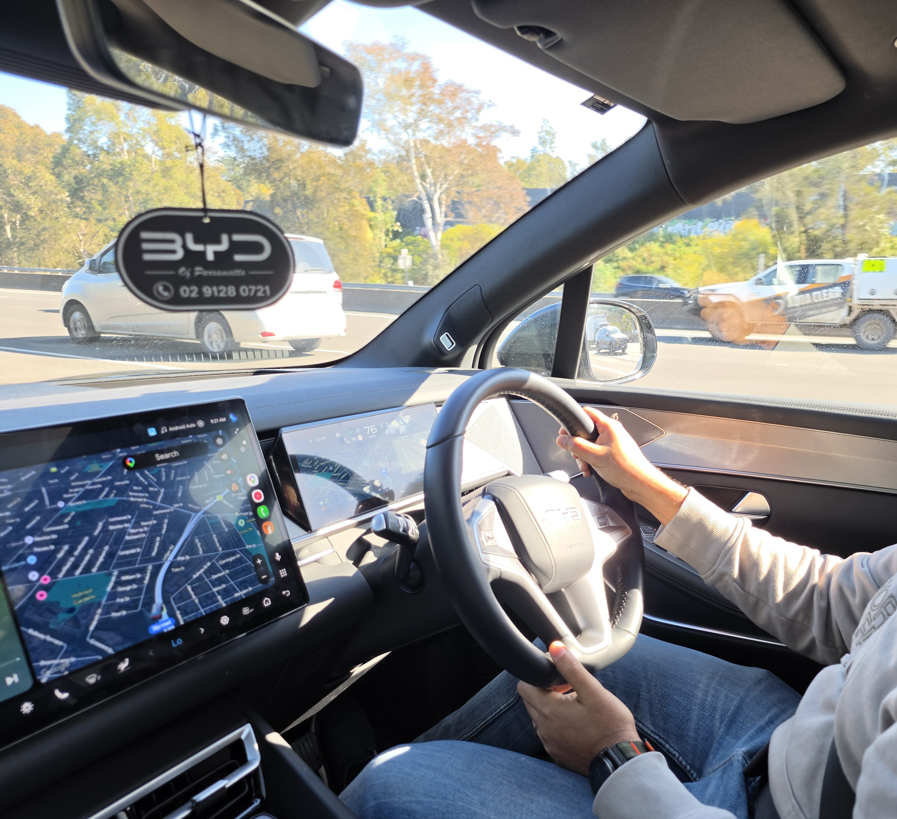

## What I Couldn't Test

Some features interested me but were not practical to try during a test drive:

- **Phone apps and remote controls.** Checking the battery level and charging progress from my phone, turning on the air conditioning before getting in, and locking or unlocking the car remotely.
- **Digital keys.** Unlocking and starting the car with my phone, ideally without taking it out of my pocket. Being able to share a key with another driver would also be useful.
- **Home Assistant integrations.** Bringing battery and charging information into my existing setup, along with controls I could use in automations. Coordinating charging with solar generation or electricity prices would be particularly useful.

## Conclusion

For a smaller budget, I would pick the Geely EX5. The Inspire Extended Range was [**$45,990 before on-road costs**](https://www.carsales.com.au/editorial/details/2026-geely-ex5-gets-a-bigger-battery-for-1000-extra-151505/), with enough of the comfort features I wanted to make up for its less enjoyable driving feel.

The BYD Sealion 7 Performance sits awkwardly between the Geely and the Zeekr 7X at a list price of [**$63,990 before on-road costs**](https://www.carexpert.com.au/car-reviews/2026-byd-sealion-7-performance-review). I would spend less on the Geely or more on the Zeekr and skip the Sealion 7 altogether.

The Leapmotor C10 drove well, but its software and storage let it down. I would not put my money into Leapmotor or Deepal yet, given their small Australian sales: [Leapmotor at 1,168](https://web1.goauto.com.au/news/leapmotor/leapmotor-to-survive-aussie-market/2026-10-16/100731.html) and [Deepal at 924](https://autotalk.com.au/industry-news/changan-takes-deepal-distribution-back-from-inchcape) for the first nine months of 2026. Their much larger businesses overseas do not give me the same confidence in local support. If either scaled back or left Australia, I would worry about access to parts, servicing and warranty repairs.

Deepal's parent company Changan and Inchcape [agreed on a handover of Australian distribution with servicing, warranty and parts support continuing](https://www.carsguide.com.au/car-news/changan-takes-back-control-of-deepal-in-australia-what-does-that-mean-for-2026-deepal-s07). That is reassuring, but I would still want to see a stronger local presence before buying a Deepal.

XPeng's dispute with TrueEV also put me off, despite liking the G6. It [ended TrueEV's exclusivity less than two years into a five-year distribution agreement, citing missed order targets and payment problems](https://www.judgments.fedcourt.gov.au/judgments/Judgments/fca/single/2026/2026fca0380). TrueEV also [alleged that XPeng encouraged its finance providers to stop funding it](https://evcentral.com.au/this-is-getting-nasty-trueev-and-xpeng-are-in-federal-court-as-ev-distributor-alleges-unconscionable-conduct/). [TrueEV's case was dismissed after it failed to provide further security for costs](https://www.judgments.fedcourt.gov.au/judgments/Judgments/fca/single/2026/2026fca1200), without those misconduct allegations going to trial. How a company treats its partners matters to me. The agreed Changan and Inchcape handover shows there are more civil ways to change distribution arrangements. XPeng's dispute with TrueEV is enough to stop me buying one of its cars.

The Zeekr 7X Performance AWD was my pick at the premium end. At a list price of [**$72,900 before on-road costs**](https://www.chasingcars.com.au/reviews/midsize-suvs/zeekr-7x-performance-awd-2026-review/), it offered the air suspension, massage seats and spacious cabin I wanted. The Model Y was my favourite to drive, but I valued the 7X's comfort more for everyday use, so that is the car I bought.

I have already written about my [Novated Lease Reviewer Skill](/novated-lease-reviewer-skill/) and [sideloading Android apps on the 7X](/zeekr-7x-sideloading-apps/). I will cover ownership in a separate post.
